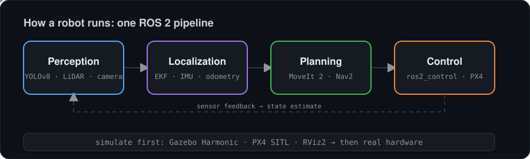

 

**Mechatronics student building robots that sense, decide and move.**
I simulate first, then bring the design onto hardware.

---

## 🧭 Focus

- **Mobile robots and manipulators** in ROS 2, from mecanum and differential drive to multi-joint arms
- **Simulation-first development** with Gazebo, PX4 SITL and physics-based grasping
- **Perception and estimation**: object detection, sensor fusion with EKF, signal filtering
- **Edge AI** and learning-based control

## 🔁 How a robot runs

## 🛠️ Tech stack

**Languages**

**Robotics and simulation**

**Estimation, vision and learning**

**Platform and workflow**

